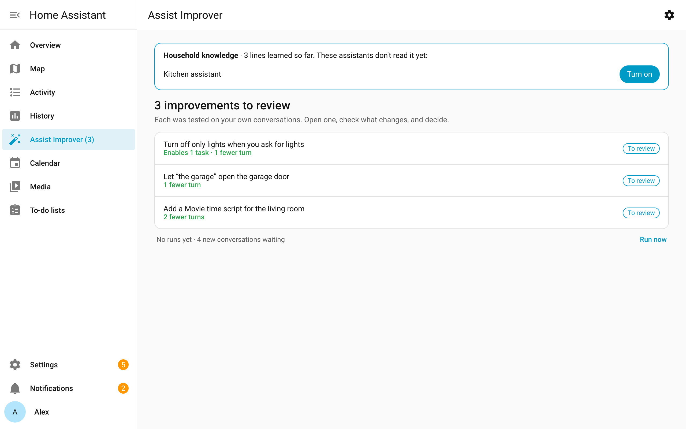
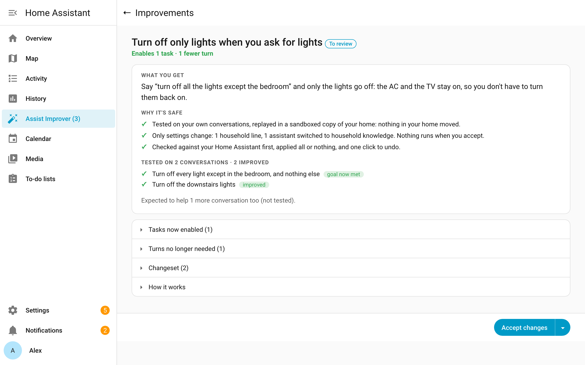
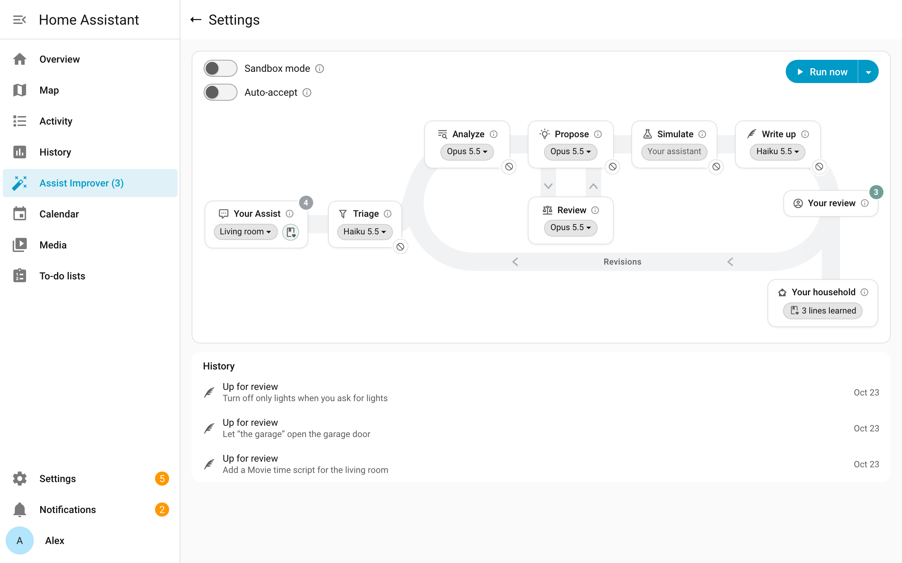

# Assist Improver

**Your Home Assistant's AI, easier every week.**

> 🚧 In development, and currently being tested in my household on Home Assistant 2026.10.3.

## How it works

Think of a self-driving car. Every time the driver takes the wheel back, that's an *intervention*, and each one teaches the car where it still falls short.

The best self-driving is one you never feel the need to supervise: **you just enjoy the ride.**

Assist Improver aims for that with your assistant. The goal is to cut the effort it takes you to get what you wanted, whether that's a change in your home or an answer to a question. It measures that effort two ways: goals that went unmet (the assistant guessed or missed what you wanted), and the extra turns you spent repeating, correcting or clarifying. A fix has to get more of your goals met first, and in fewer turns second.

1. **Learns from your own use.** Keeps your Assist conversations and their results in your Home Assistant, next to the history it already keeps. It's as private as your Home Assistant setup.
2. **Thinks.** A deep-thinking AI looks for where you had to step in and proposes changes that would have spared you the effort.
3. **Tests.** Replays the same conversations with each change, as a counterfactual experiment, on your own assistant. The replay runs in a sandboxed copy of your Home Assistant, set up as your home was during that conversation: Home Assistant's own logic, scripts and automations run there, and only your devices are simulated, so nothing in your home moves.
4. **Asks you.** Only changes that proved they save effort reach you. You approve, ask for a revision, or decline.

Approved improvements stay even if you uninstall Assist Improver.

The principles behind each step: [Design principles](docs/DESIGN.md).

## Where we are

- [x] Record conversations
- [x] Replay a conversation safely, with simulated devices
- [x] Prepare conversations for AI analysis, and choose the AI model
- [x] Find journeys and interventions
- [x] Spot recurring problems and propose fixes
- [x] Build and test the fixes
- [x] Review and apply them in Home Assistant
- [x] Run when you choose, or on a schedule
- [ ] Ready for other households **<===== we are here**

## Getting started

1. **Install** through [HACS](https://hacs.xyz): add this repository as a custom repository (type **Integration**), download **Assist Improver**, and restart Home Assistant.
2. **Add it:** Settings → Devices & services → Add integration → **Assist Improver**. Keep the recommended AI model: Claude Opus 5.5 does the thinking, and a small model is added for the quick steps.
3. **Use Assist as usual.**
4. **Run it:** open **Assist Improver** in the sidebar and choose **Run now**. Before anything starts, it tells you what the run will do and that it costs money with your AI providers.
5. **Review:** you're told when improvements are ready. Open one, check what changes, and accept it.

That's it. Good to know:

- **Nothing in your home changes until you accept.** Tests run in a sandboxed copy of your home. Accepted changes apply all at once, can be undone, and stay if you uninstall.
- **Every assistant benefits.** What the improver learns about your household reaches all your assistants, without setup.
- **Your conversations stay in your Home Assistant.** Analysis sends what it needs to the AI model you chose.
- **Settings** (the gear in the panel) are optimized by default: each step of the pipeline, its AI model, and what waits at it. If a model goes missing, the step says so before a run spends anything.

## License

[Apache 2.0](LICENSE)
