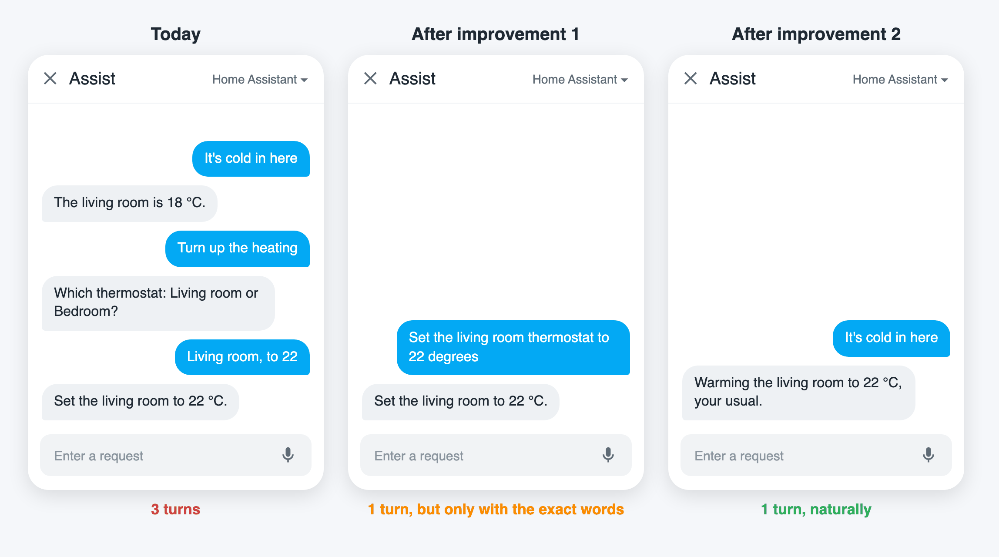

# Assist Improver

**Your Home Assistant's AI, easier every week.**

> 🚧 In development, and currently being tested in my household on Home Assistant 2026.10.2.

## How it works

Think of a self-driving car. Every time the driver takes the wheel back, that's an *intervention*, and each one teaches the car where it still falls short.

The best self-driving is one you never feel the need to supervise: **you just enjoy the ride.**

Assist Improver aims for that with your assistant. The goal is to cut the effort it takes you to get what you wanted, whether that's a change in your home or an answer to a question. It measures that effort two ways: goals that went unmet (the assistant guessed or missed what you wanted), and the extra turns you spent repeating, correcting or clarifying. A fix has to get more of your goals met first, and in fewer turns second.

1. **Learns from your own use.** Keeps your Assist conversations and their results in your Home Assistant, next to the history it already keeps. It's as private as your Home Assistant setup.
2. **Thinks.** A deep-thinking AI looks for where you had to step in and proposes changes that would have spared you the effort.
3. **Tests.** Replays the same conversations with each change, as a counterfactual experiment, on your own assistant. The replay runs in a sandboxed copy of your Home Assistant, set up as your home was during that conversation: Home Assistant's own logic, scripts and automations run there, and only your devices are simulated, so nothing in your home moves.
4. **Asks you.** Only changes that proved they save effort reach you. You approve, ask for a revision, or decline.

Approved improvements stay even if you uninstall Assist Improver.

The principles behind each step: [Design principles](docs/DESIGN.md).

## Where we are

- [x] Record conversations
- [x] Replay a conversation safely, with simulated devices
- [x] Prepare conversations for AI analysis, and choose the AI model
- [x] Find journeys and interventions
- [x] Spot recurring problems and propose fixes
- [x] Build and test the fixes
- [ ] Review and apply them in Home Assistant **<===== we are here**
- [ ] Run on its own schedule
- [ ] Ready for other households

## Getting started

<!-- Screenshots for each step come from a demo household (no real home), generated with the project's UI checks. -->

### 1. Install

Through [HACS](https://hacs.xyz):

1. HACS → ⋮ → **Custom repositories**: add this repository's URL, type **Integration**.
2. Download **Assist Improver**, then restart Home Assistant.

<!-- screenshot: HACS custom repository dialog -->

### 2. Add it and choose its AI model

**Settings → Devices & services → Add integration → Assist Improver.** Pick the AI model the improver's own roles use. The recommended option is created for you with your AI provider's own setup; keep it for the best results. If the model you pick may be too weak, Assist Improver says why and lets you go back.

<!-- screenshot: setup dialog with the recommended AI model selected -->

### 3. Check the settings

**Assist Improver → Configure → Settings** holds every setting in one place:

- **AI model:** the one you chose above.
- **Tests per goal:** how many fixes each goal is tested with, in each conversation where it came up. Each test replays that conversation on your own assistant, so this multiplies what those conversations cost: with 3, testing costs about three times as much.
- **Quick-check model** (optional): a small, cheap model that checks each conversation first. One it's sure went smoothly skips the full analysis, which saves its cost. Leave it empty to analyse every conversation.
- **Follow-up check model** (optional): a small model that checks that replayed follow-up messages still fit the conversation.

<!-- screenshot: Configure → Settings -->

### 4. Use Assist as you normally do

Talk to your assistant as usual, by voice or text. Assist Improver keeps each conversation and what happened in your home during it. There's nothing to do differently: the conversations where you had to repeat, correct or clarify yourself are what it learns from.

### 5. Review improvements

When a tested improvement is ready, a notification takes you to it. Open **Assist Improver → Configure → Improvements**, or find it in **Settings → Repairs**; deciding in one place updates the other.

Each improvement reads like a code review:

- what it gets you, such as *Enables 1 task · 2 fewer turns*;
- **Tasks now enabled** and **Turns no longer needed**, the goals it meets and the extra messages it saves you;
- the **Changeset**, one line per change, each opening to exactly what changes in Home Assistant;
- **Why**, with the conversations it was tested on.

<!-- screenshot: an improvement, collapsed -->
<!-- screenshot: an improvement with one change opened to its diff -->

Choose **Accept changes** and **Submit**, or pick another decision from the list: ask for a revision, decline, say things were fine as they were, or mark the conversation as a test. Accepting checks everything against your Home Assistant first, applies all of the changes or none of them, and runs nothing. An accepted improvement can be undone from the same screen.

### For now: starting the analysis

Until Assist Improver runs on its own schedule, an administrator starts each step from **Developer tools → Actions**: *Analyze recording*, then *Generate hypotheses*, then *Test hypotheses*. Each one says what it costs and needs **Allow paid inference** switched on. Improvements that pass their tests then appear for review.

## Your data and costs

- Your conversations stay in your Home Assistant, as private as the rest of your setup.
- Analysis sends a summary of them to the AI model you chose, through Home Assistant's own AI Task. It runs only when you allow it, because it can cost money with your AI provider.
- Testing a fix replays your conversation on your own assistant, so it costs about what that conversation did. The **Tests per goal** setting caps it: with 3, testing costs roughly three times those conversations.

## License

[Apache 2.0](LICENSE)
