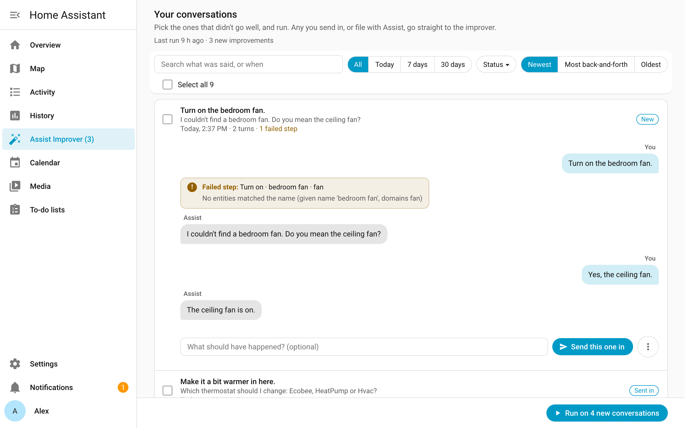
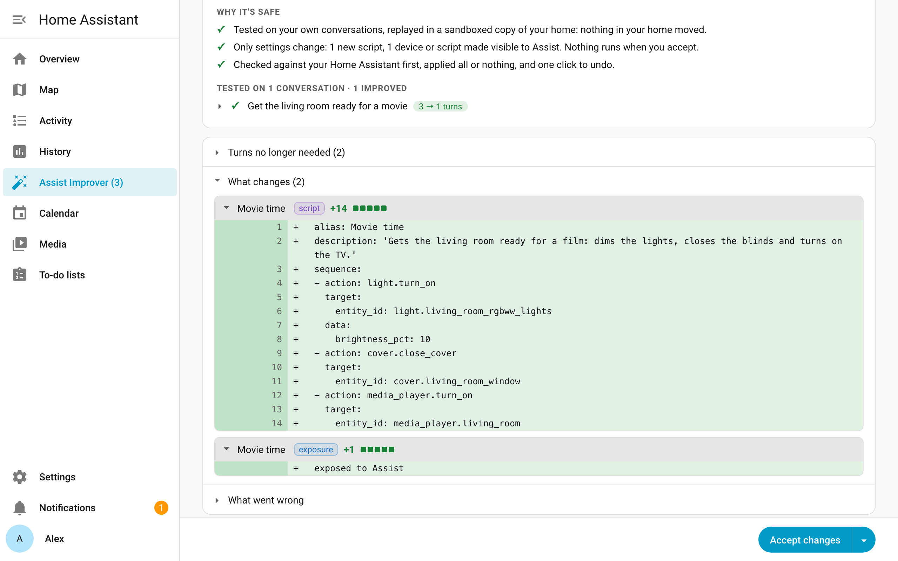

# Assist Improver

**Your Home Assistant's AI, easier every week.**

> **Early release.** Used every day in my household, on Home Assistant 2026.10.3. Tell me how it works in yours: [open an issue](https://github.com/thngkaiyuan/ha-assist-improver/issues).

## How it works

Think of a self-driving car. Every time the driver takes the wheel back, that's an *intervention*, and each one teaches the car where it still falls short.

The best self-driving is one you never feel the need to supervise: **you just enjoy the ride.**

Assist Improver aims for that with your assistant. The goal is to cut the effort it takes you to get what you wanted, whether that's a change in your home or an answer to a question. It measures that effort two ways: goals that went unmet (the assistant guessed or missed what you wanted), and the extra turns you spent repeating, correcting or clarifying. Every change has to leave you better off, and never worse.

1. **Learns from your own use.** Keeps your Assist conversations and their results in your Home Assistant, next to the history it already keeps. It's as private as your Home Assistant setup.
2. **Thinks.** A deep-thinking AI looks for where you had to step in and proposes changes that would have spared you the effort.
3. **Tests.** Replays the same conversations with each change, as a counterfactual experiment, on your own assistant. The replay runs in a sandboxed copy of your Home Assistant, set up as your home was during that conversation: Home Assistant's own logic, scripts and automations run there, and only your devices are simulated, so nothing in your home moves.
4. **Asks you.** Only changes that proved they save effort reach you. You approve, ask for a revision, or decline.

Approved improvements stay even if you uninstall Assist Improver.

The principles behind each step: [Design principles](docs/DESIGN.md).

## Where we are

Every step above works end to end, and runs every day in my household. This is the first release for other households: your conversations will show it things mine never did, and your feedback decides what comes next.

## Getting started

1. **Install** through [HACS](https://hacs.xyz): add this repository as a custom repository (type **Integration**), download **Assist Improver**, and restart Home Assistant.
2. **Add it:** Settings → Devices & services → Add integration → **Assist Improver**. Keep the recommended AI model: Claude Opus 5.5 does the thinking, and a small model is added for the quick steps.
3. **Use Assist.** When a conversation doesn't go the way you wanted, ask Assist to file an improvement. It takes the fast lane: the improver studies it as soon as the conversation ends, with no run to start.
4. **Send in past conversations:** open **Assist Improver** in the sidebar. Your conversations are listed there, and you can find one by what was said or when. Pick the ones that didn't go well, and run them. Before anything starts, it tells you what the run will do and that it costs money with your AI providers. Rather leave it all to the improver, and don't mind spending more tokens? Set a schedule in its settings, and every conversation goes to the improver.
   

5. **Review:** you're told when improvements are ready. Open one, check what changes, and accept it. Turn on auto-accept for low-risk changes in the settings, and those fixes apply themselves (you're told each time, and can undo).

That's it. Good to know:

- **Nothing in your home changes until you accept.** Tests run in a sandboxed copy of your home. Accepted changes apply all at once, can be undone, and stay if you uninstall.
- **Every assistant benefits.** What the improver learns about your household reaches every assistant that controls Home Assistant.
- **Tested with Anthropic and OpenRouter.** Other AI providers should work too.
- **Settings** (the gear in the panel) are optimized by default: each step of the pipeline, its AI model, and what waits at it. If a model goes missing, the step says so before a run spends anything.

## Your data

- **Kept in your Home Assistant:** your Assist conversations (what was said, what Assist did, and how your home was at each turn), stored next to the history Home Assistant already keeps.
- **Sent during a run:** the AI models you chose get what they need to do their work. Nothing comes to us.
- **For how long:** conversations are kept in full for at least 30 days, then condensed, keeping enough for the improver to see your household's needs as a whole. Its own logs are kept only as long as they're useful, a year at most.
- **Uninstalling** removes everything the improver stored and the AI Tasks it set up. Your accepted improvements stay.
- **You decide what's kept:** turn recording off for anyone, archive a conversation, or delete it for good.

## License

[Apache 2.0](LICENSE)
